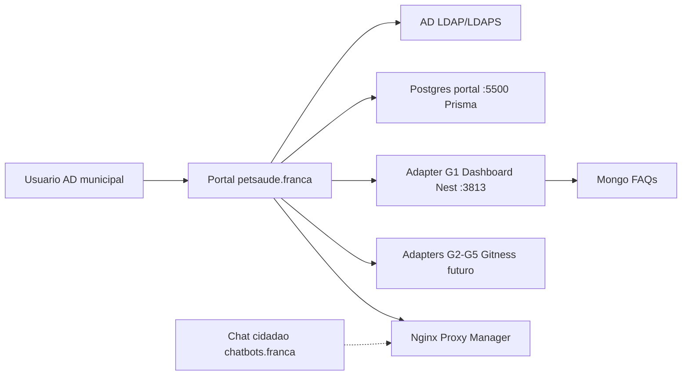

# Portal PET Saúde Digital

## Objetivo

Concentrar controle, parametrização, administração, relatórios, dashboards e acompanhamento do PET Saúde Digital 2025 em `petsaude.franca.sp.gov.br`, com espaços por grupo e controle de acesso por conta (AD municipal), separado do chat cidadão em `chatbots.franca.sp.gov.br`.

## Escopo

**Dentro do escopo (MVP):**

- Shell web no padrão visual Bot_Pan (menu esquerdo, painéis colapsáveis, paleta)
- Login LDAP/LDAPS direto na API do portal
- Cadastro de vínculos usuário × grupo × papel PET
- Workspaces dos cinco grupos (G1 operacional via adapter; G2–G5 placeholder até certificados/APIs)
- Importação do Dashboard/FAQ do Grupo 1 (ChatBot) via adapter HTTP
- Documentos públicos (LGPD, normativas) e página Sobre
- Relatórios consolidados PET com indicadores G1 no primeiro corte
- Hospedagem em `/srv/pet-saude/portal/portal-pet-saude` (VM082)

**Fora do escopo (MVP):**

- Reescrita hexagonal completa do Dashboard Nest legado
- Desligar espelho Vercel do Dashboard-PetSaude
- Substituir o SIG-PET InfoSD do Ministério da Saúde
- Certificados e adapters finais G2–G5 (fase posterior por grupo)
- SSO OIDC/SAML (fica LDAP direto)

## Partes interessadas

| Papel | Área | Interesse |
|---|---|---|
| Gestor PET | Secretaria de Saúde / coordenação municipal | Governança, cadastros, relatórios MS |
| Coordenador de grupo | IES / grupo tutorial | Planejamento e monitoramento do grupo |
| Tutores, preceptores, orientadores, monitores, participantes | Grupos G1–G5 | Execução e acompanhamento das atividades |
| DTI | Infra municipal | AD, DNS, portas, proxy TLS |
| Cidadão | Público | **Não** é usuário deste portal (usa o chat) |

## Contexto (C4 nível 1)

## Decisões de estudo (rastreio)

Ver plano F/S/P e ADRs: caminho `/srv/pet-saude/portal/portal-pet-saude`, UX Bot_Pan, adapter C para G1, AD direto, papéis institucionais PET, espelho Vercel mantido, Postgres próprio `5500`.
